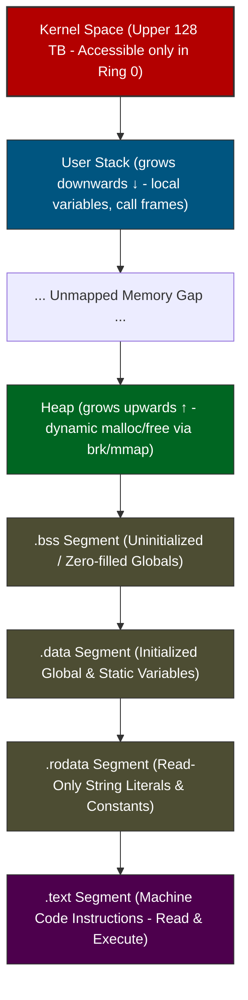
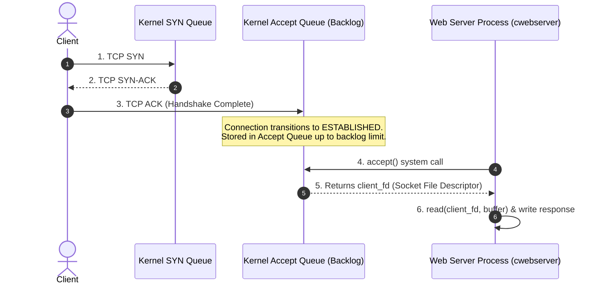

<div align="center">

# 🖥️ Fundamentals of Operating Systems — Course & Labs Companion

[](https://www.udemy.com/course/fundamentals-of-operating-systems/)
[](https://www.youtube.com/@hnasr)
[](https://en.wikipedia.org/wiki/C_(programming_language))
[](https://www.kernel.org/)
[](./LICENSE)
[](./.github/workflows/ci.yml)

<p align="center">
  <strong>An engineering-first, hands-on repository covering core operating system internals, process anatomy, virtual memory, CPU cache lines, socket buffers, page cache, and copy-on-write (COW).</strong>
</p>

[Course Overview](#-course-overview) •
[Architecture & Concepts](#-architecture--concepts) •
[Labs Index](#-hands-on-labs-index) •
[Quickstart](#-quickstart--environment-setup) •
[Curated Resources](#-curated-os-learning-resources) •
[Tooling Guide](#-kernel-diagnostic--inspection-tools)

---

</div>

## 📌 Course Overview

This repository is a structured companion for the celebrated course [**Fundamentals of Operating Systems**](https://www.udemy.com/course/fundamentals-of-operating-systems/) taught by **Hussein Nasser** ([os.husseinnasser.com](https://os.husseinnasser.com)).

Software engineers often treat the operating system as an invisible black box. When queries run slowly, connections hang, or servers run out of memory, the root cause almost always lies within the interaction between application code and the OS kernel:
- How does the kernel translate program instructions into executing processes?
- Why does memory allocation cost scale exponentially when fragmented into millions of objects?
- How does Copy-On-Write (COW) protect memory while creating hidden traps for runtimes like Python?
- What happens inside the OS Accept Queue and SYN Queue when a web server experiences traffic spikes?
- Why did a simple SQLite `fsync()` freeze entire operating systems in Firefox 3?

This repository turns theoretical operating system lectures into **repeatable, benchmarked, and annotated hands-on labs**.

---

## 🏗️ Architecture & Concepts

### 1. Process Virtual Memory Layout (x86_64)



### 2. Network Socket Queue Architecture



---

## 🧪 Hands-On Labs Index

| Lab | Directory | Course Module | Core System Concepts | Diagnostic Tools |
|:---:|:---|:---|:---|:---|
| **01** | [`01-process-anatomy`](file:///labs/01-process-anatomy) | *Section 3: Anatomy of a Process* | ELF segments, compilation pipeline, instruction decoding, register movement | `objdump`, `readelf`, `size`, `gcc -S` |
| **02** | [`02-stack-memory`](file:///labs/02-stack-memory) | *Section 3: Anatomy of a Process* | Stack frames, prologue/epilogue, `%rsp`, `%rbp`, return address `%rip` | `gdb`, assembly listings |
| **03** | [`03-data-segment`](file:///labs/03-data-segment) | *Section 3: Anatomy of a Process* | `.data` vs `.bss` vs `.rodata`, RIP-relative addressing, global lifecycle | `nm`, `readelf -S` |
| **04** | [`04-heap-allocation`](file:///labs/04-heap-allocation) | *Section 4: Memory Management* | `malloc()`, `free()`, `brk()`, `mmap()`, chunk headers, memory leaks | `valgrind`, `strace` |
| **05** | [`05-allocation-benchmarks`](file:///labs/05-allocation-benchmarks) | *Section 4: Memory Management* | Allocator overhead: 1M individual mallocs vs 1 contiguous block allocation | `/usr/bin/time -v`, heap profiling |
| **06** | [`06-process-fork-cow`](file:///labs/06-process-fork-cow) | *Section 6: Process Management* | `fork()`, PID, Copy-On-Write (COW), zero-cost page sharing, page faults | `pmap`, `/proc/[pid]/smaps` |
| **07** | [`07-socket-webserver`](file:///labs/07-socket-webserver) | *Section 8: Socket Management* | Accept backlog queue, send/recv buffers, slow clients, TCP zero-window probe | `ss -lntp`, `curl`, `tcpdump`, Python test harness |
| **08** | [`08-cpu-cache-locality`](file:///labs/08-cpu-cache-locality) | *Section 5: Inside The CPU* | L1/L2/L3 cache lines (64B), spatial locality, row-major vs column-major matrix traversal | `perf stat`, clock timers |
| **09** | [`09-storage-page-cache`](file:///labs/09-storage-page-cache) | *Section 7: Storage Management* | OS Page Cache, dirty pages, asynchronous writeback, `fsync()` durability cost | `/proc/meminfo`, microsecond benchmarks |

---

## 🚀 Quickstart & Environment Setup

You can run these labs on **Linux**, **macOS**, or **Windows (via WSL2 or Docker)**.

### Option A: Instant Zero-Install Lab Container (Recommended)

Requires [Docker Desktop](https://www.docker.com/products/docker-desktop/):

```bash
# Clone the repository
git clone https://github.com/Sohila-Khaled-Abbas/fundamentals-of-operating-systems-labs.git
cd fundamentals-of-operating-systems-labs

# Start and enter the fully equipped Linux environment
docker compose up -d
docker compose exec os-lab bash
```

Inside the container, run:
```bash
make all   # Builds all 9 labs
make test  # Runs automated benchmarks
```

---

### Option B: Native Linux / macOS / WSL2

Ensure `gcc`, `make`, and standard development headers are installed:

```bash
# Debian / Ubuntu / WSL2
sudo apt update && sudo apt install -y build-essential gcc make gdb strace valgrind curl python3

# macOS (Homebrew)
brew install gcc make

# Build everything
make all

# Run all safe benchmarks
make test
```

---

### Option C: Windows Native (PowerShell + GCC)

```powershell
# Compile individual benchmark labs using installed GCC
gcc -Wall -O2 -o labs\08-cpu-cache-locality\cache_locality.exe labs\08-cpu-cache-locality\cache_locality.c
.\labs\08-cpu-cache-locality\cache_locality.exe

gcc -Wall -O2 -o labs\09-storage-page-cache\page_cache_sync.exe labs\09-storage-page-cache\page_cache_sync.c
.\labs\09-storage-page-cache\page_cache_sync.exe
```

> [!TIP]
> Labs involving POSIX system calls (`fork()` in Lab 06 and `<sys/socket.h>` in Lab 07) run natively under **WSL2** or the included **Docker** container.

---

## 🔍 Kernel Diagnostic & Inspection Tools

Mastering operating systems requires inspecting live kernel state. Here is your essential toolkit:

```bash
# 1. Syscall Tracing: View every system call executed by a binary
strace -T -e trace=brk,mmap,write ./my_program

# 2. Binary Segment Analysis: View ELF section headers & sizes
readelf -S ./binary
size ./binary

# 3. Disassembly: Inspect x86_64 instructions with Intel syntax
objdump -d -M intel ./binary

# 4. Process Memory Maps: Inspect virtual memory & physical RSS allocation
pmap -x <PID>
cat /proc/<PID>/smaps | grep -E "Shared_Dirty|Private_Dirty|Rss"

# 5. Socket Queue Inspection: Check pending connections in Accept Queue
# Send-Q = Max Listen Backlog | Recv-Q = Connections waiting for accept()
ss -lntp

# 6. Hardware Performance Counters: Count L1 cache misses & CPU cycles
perf stat -e cycles,instructions,L1-dcache-load-misses ./binary
```

For more details, see the [`docs/os-cheat-sheet.md`](file:///docs/os-cheat-sheet.md).

---

## 📚 Curated OS Learning Resources

An annotated collection of the most authoritative literature, courses, and tools online:

### 📖 Classic & Free Textbooks
- 🌟 [**Operating Systems: Three Easy Pieces (OSTEP)**](https://pages.cs.wisc.edu/~remzi/OSTEP/) by *Remzi & Andrea Arpaci-Dusseau* — The modern gold standard. Freely accessible online. Structured around Virtualization, Concurrency, and Persistence.
- [**Computer Systems: A Programmer's Perspective (CS:APP)**](https://csapp.cs.cmu.edu/) by *Bryant & O'Hallaron* — Unrivaled for understanding how compilers, processors, and the OS execute code.
- [**The Linux Programming Interface (TLPI)**](https://man7.org/tlpi/) by *Michael Kerrisk* — The comprehensive encyclopedia of Linux systems programming and kernel interfaces.
- [**Systems Performance: Enterprise and the Cloud (2nd Ed)**](https://www.brendangregg.com/systems-performance-2nd-edition-book.html) by *Brendan Gregg* — Deep diagnostic methodology, eBPF, CPU profiling, and memory observability.

### 🎓 Top University Open Courseware
- [**MIT 6.S081 / 6.828: Operating System Engineering**](https://pdos.csail.mit.edu/6.828/) — Build OS primitives from scratch on xv6 RISC-V.
- [**UC Berkeley CS 162: Operating Systems & Systems Programming**](https://cs162.org/) — Virtual memory, scheduling, file systems, and distributed consensus.
- [**Stanford CS 111 / CS 140: Operating Systems Principles**](https://web.stanford.edu/class/cs140/) — Foundational OS principles and Pintos projects.

### 🌐 Seminal War Stories & Articles (Cited in Course)
- [A War Story Involving a Python, a Fork, a Cow, and a Bug](https://codeconfessions.substack.com/p/a-war-story-involving-a-python-a) — Instagram's discovery of why Python reference counting breaks Copy-On-Write page sharing.
- [Let's make PostgreSQL multi-threaded](https://www.postgresql.org/message-id/31cc6df9-53fe-3cd9-af5b-ac0d801163f4%40iki.fi) & [The Objections by Andres Freund](https://www.postgresql.org/message-id/20230607213721.al3etgcgtija3ytz%40awork3.anarazel.de) — Why process isolation beat multi-threading for PostgreSQL database architecture.
- [Firefox 3 uses fsync excessively](https://bugzilla.mozilla.org/show_bug.cgi?id=421482) — How synchronous disk flushes blocked the entire Linux Page Cache journal.
- [Sharing page tables with `mshare()`](https://lwn.net/Articles/895217/) — Linux kernel architecture for sharing page tables across large database instances.

For the full catalog of references, see [`docs/references.md`](file:///docs/references.md).

---

## 📁 Repository Structure

```
.
├── .github/
│   └── workflows/
│       └── ci.yml               # Automated CI build & test pipeline
├── docs/
│   ├── os-cheat-sheet.md        # Registers, syscalls, and diagnostic commands
│   └── references.md            # Course citations, textbooks, and seminal papers
├── labs/
│   ├── 01-process-anatomy/      # Section 3: Machine code, ELF, assembly
│   ├── 02-stack-memory/         # Section 3: Stack frames, RSP/RBP calling conventions
│   ├── 03-data-segment/         # Section 3: .data, .bss, .rodata, RIP-relative addressing
│   ├── 04-heap-allocation/      # Section 4: malloc, free, brk, mmap, leaks
│   ├── 05-allocation-benchmarks/# Section 4: Allocator overhead: 1M mallocs vs 1 chunk
│   ├── 06-process-fork-cow/     # Section 6: fork(), Copy-On-Write, page table duplication
│   ├── 07-socket-webserver/     # Section 8: Sockets, listen backlog, buffers, TCP zero window
│   ├── 08-cpu-cache-locality/   # Section 5: L1/L2/L3 cache lines & matrix spatial locality
│   └── 09-storage-page-cache/   # Section 7: OS Page Cache, dirty pages, fsync durability
├── .gitattributes               # Line ending normalization (LF)
├── .gitignore                   # Ignores binaries, debug symbols, .DS_Store
├── Dockerfile                   # Complete Ubuntu systems programming container
├── docker-compose.yml           # One-click Docker container definition
├── LICENSE                      # MIT Open Source License
├── Makefile                     # Root build automation (make all, clean, test)
└── README.md                    # Main documentation
```

---

## 🤝 Contributing & Study Workflow

Contributions to improve labs, expand test scripts, or add diagnostic walkthroughs are welcome!

1. Fork the repository.
2. Create a feature branch: `git checkout -b feature/new-lab-experiment`.
3. Verify that all labs compile and pass tests: `make all && make test`.
4. Commit your changes with clear messages.
5. Push to your branch and submit a Pull Request.

---

## 📜 License

Distributed under the **MIT License**. See [`LICENSE`](file:///LICENSE) for full details.

<div align="center">
  <sub>Built with ❤️ for learners of Operating Systems, Backend Engineering, and Systems Programming.</sub>
</div>
